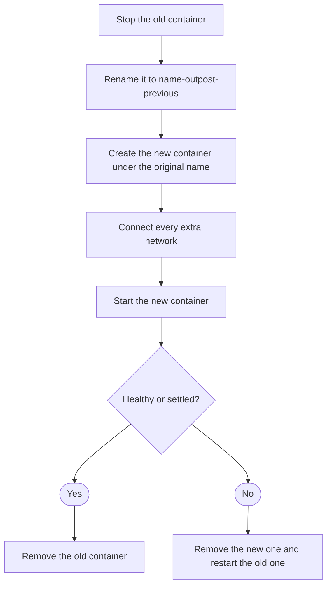

import { Terminology } from '@cbnventures/docusaurus-preset-nova/blocks';

Replace a container with one running the new image, keep everything that made it yours, and get the old one back if the new one fails.

## Why Use This Feature?

1. Restores the previous container when the new one stops, turns unhealthy, or never settles so a bad release doesn't take your service down.
2. Reattaches anonymous volumes by name so data that lives in an unnamed volume is still there after the update.
3. Drops settings that were only defaults of the old image so the new image's command, ports, and environment defaults take effect.
4. Checks the registry before pulling so containers that are already current are never downloaded again.

## Checking for a New Image

For each container, Outpost decides whether a newer image exists:

1. **Ask the registry** — Outpost requests the <Terminology title="registry manifest digest for an image tag" to="/docs/reference/terminology#remote-digest">remote digest</Terminology> for the container's image tag. If it matches the running image, the container is `up-to-date` and nothing is downloaded.
2. **Pull and compare** — If the digests differ, or the registry can't be asked, Outpost pulls the tag. If the pulled image is the one already running, the container is `up-to-date`.
3. **Decide** — A <Terminology title="report updates without recreating containers" to="/docs/reference/terminology#monitor-only">monitor-only</Terminology> container is reported as `available`. Every other container goes on to <Terminology title="swapping a container onto the new image" to="/docs/reference/terminology#recreation">recreation</Terminology>.

## Recreating the Container

The old container is renamed rather than removed until the new one has proven itself. Its volumes are never deleted.

### What Carries Over

- **Configuration** — Environment, labels, command, entrypoint, user, working directory, restart policy, ports, devices, and resource limits.
- **Volumes** — Bind mounts, named volumes, and anonymous volumes, which are reattached by name so their data survives.
- **Networks** — Every network the container was on, with its aliases, static IP addresses, and links.

### What Is Dropped

Settings that were inherited unchanged from the old image are removed so the new image can supply its own:

- Command, entrypoint, working directory, user, healthcheck, and stop signal, when they equal the old image's values.
- Environment variables, labels, exposed ports, and volume declarations that match the old image entry for entry.
- The hostname, when it was just the old container's ID.

Anything you set yourself, such as an environment variable in your Compose file, is kept even if the new image changes its default.

## Health and Settle Checks

After starting the new container, Outpost checks on it every second:

- **With a healthcheck** — It must report `healthy` within `OUTPOST_HEALTH_TIMEOUT` seconds (default `120`).
- **Without a healthcheck** — It must still be running after the <Terminology title="how long a container must keep running" to="/docs/reference/terminology#settle-period">settle period</Terminology>, `OUTPOST_SETTLE_SECONDS` (default `10`).

The update fails as soon as the container stops or reports `unhealthy`. It is recommended to keep the <Terminology title="how long a container must keep running" to="/docs/reference/terminology#settle-period">settle period</Terminology> shorter than the health timeout, since the health timeout also ends the wait.

## Rollback

When anything goes wrong after the old container was stopped, Outpost performs a <Terminology title="restoring the previous container after a failure" to="/docs/reference/terminology#rollback">rollback</Terminology>:

1. Removes the new container, if one was created.
2. Renames the old container back to its original name.
3. Starts the old container again.

The result is `rolled-back`, with the reason in its detail, such as `New container is unhealthy; rolled back to the previous container`. If the <Terminology title="restoring the previous container after a failure" to="/docs/reference/terminology#rollback">rollback</Terminology> itself fails, the result is `failed` and the detail explains both errors.

## Cleanup

With `OUTPOST_CLEANUP` on (the default), the old image is removed after a successful update. If another container still uses that image, it is kept and the update still counts as successful.

## Result Statuses

Every container in a <Terminology title="one pass over all selected containers" to="/docs/reference/terminology#cycle">cycle</Terminology> gets one of these statuses in the <Terminology title="per-container results of a cycle" to="/docs/reference/terminology#report">report</Terminology>:

| Status        | Meaning                                                                                                                                                                                        |
|---------------|------------------------------------------------------------------------------------------------------------------------------------------------------------------------------------------------|
| `updated`     | Recreated on the new image and passed the health or settle check.                                                                                                                              |
| `available`   | A newer image exists, but the container is <Terminology title="report updates without recreating containers" to="/docs/reference/terminology#monitor-only">monitor-only</Terminology>.         |
| `up-to-date`  | The running image is already the newest one for its tag.                                                                                                                                       |
| `skipped`     | Outpost itself, a pinned image, or a shared network namespace.                                                                                                                                 |
| `rolled-back` | The new container failed and the previous one was restored.                                                                                                                                    |
| `failed`      | The check, pull, or <Terminology title="restoring the previous container after a failure" to="/docs/reference/terminology#rollback">rollback</Terminology> failed. The detail holds the error. |

One container's failure never stops the <Terminology title="one pass over all selected containers" to="/docs/reference/terminology#cycle">cycle</Terminology>; Outpost records it and moves on to the next container. Only one <Terminology title="one pass over all selected containers" to="/docs/reference/terminology#cycle">cycle</Terminology> runs at a time, whether it was started by the schedule or the API.
