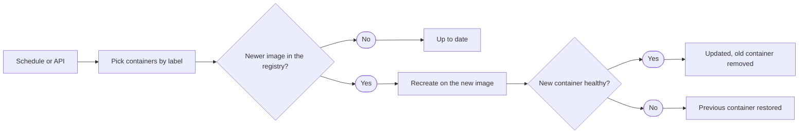

import { Terminology } from '@cbnventures/docusaurus-preset-nova/blocks';

Keep every container on your Docker host current, and get the previous container back automatically when an update breaks.

## What Is This?

**Outpost** is a self-hosted container updater for a single Docker host. On a schedule you choose, it checks each container's registry for a newer image and recreates the container on that image with the same settings, volumes, and networks.

If the new container stops or reports unhealthy, Outpost puts the old one back. It ships as one small image that needs nothing but access to the Docker socket.

## Why Use Outpost?

1. Restores the previous container when an update fails so a broken image doesn't leave your service down overnight.
2. Carries over volumes, including anonymous ones, and every network attachment so your data and connectivity survive the swap.
3. Asks the registry before downloading anything so containers that are already current cost almost nothing to check.
4. Lets you choose what gets updated with labels, or just be told about new images, so cautious services stay under your control.
5. Runs its updater as a regular user rather than root so the process that touches your containers has no more access than it needs.

## Key Capabilities

- **Automatic rollback** — A replacement that stops, turns unhealthy, or never settles is removed and the previous container is started again.
- **Safe recreation** — Environment, labels, ports, restart policy, volumes, and networks are kept, while defaults from the old image are dropped so the new image's defaults apply.
- **Digest-first checks** — Outpost compares the registry's digest with the running image before pulling.
- **Label control** — Update everything unless labeled off, or only what is labeled on, and mark single containers as <Terminology title="report updates without recreating containers" to="/docs/reference/terminology#monitor-only">monitor-only</Terminology>.
- **Dependency order** — Compose `depends_on` services are updated before the services that need them.
- **Notifications** — Get an ntfy push or a JSON webhook when something was updated, found, or failed.
- **Web dashboard** — See every container, the next check, and the last 50 checks in your browser, and start a check with one click.
- **HTTP API and metrics** — Trigger an update, read the latest results, and scrape Prometheus metrics behind a bearer token.

## How It Works

Each <Terminology title="one pass over all selected containers" to="/docs/reference/terminology#cycle">cycle</Terminology> goes through your containers one at a time and records a result for each in a <Terminology title="per-container results of a cycle" to="/docs/reference/terminology#report">report</Terminology>. The <Terminology title="per-container results of a cycle" to="/docs/reference/terminology#report">report</Terminology> feeds notifications, the dashboard, the status endpoint, and the metrics endpoint.

:::info
Outpost manages one Docker host through its local socket. Docker Swarm services, Kubernetes, and fleets of remote hosts are out of scope.
:::

## What You Will Need

- **A Docker host** — Any Linux machine running Docker Engine, such as a NAS, mini PC, or VPS, on `amd64` or `arm64`.
- **Access to the Docker socket** — Mounted into the Outpost container, usually `/var/run/docker.sock`.
- **Containers started from tagged images** — Such as `nginx:1.27` or `ghcr.io/org/app:latest`, so there is a tag to follow.

## Next Steps

- **[Quick Start](/docs/getting-started/quick-start/)** — Run Outpost with `docker run` or Docker Compose.
- **[Configuration](/docs/getting-started/configuration/)** — Every environment variable and its default.
- **[Labels and Modes](/docs/features/labels-and-modes/)** — Choose which containers are updated.
- **[Migrating from Watchtower](/docs/reference/migrating-from-watchtower/)** — Map your Watchtower settings to Outpost.
