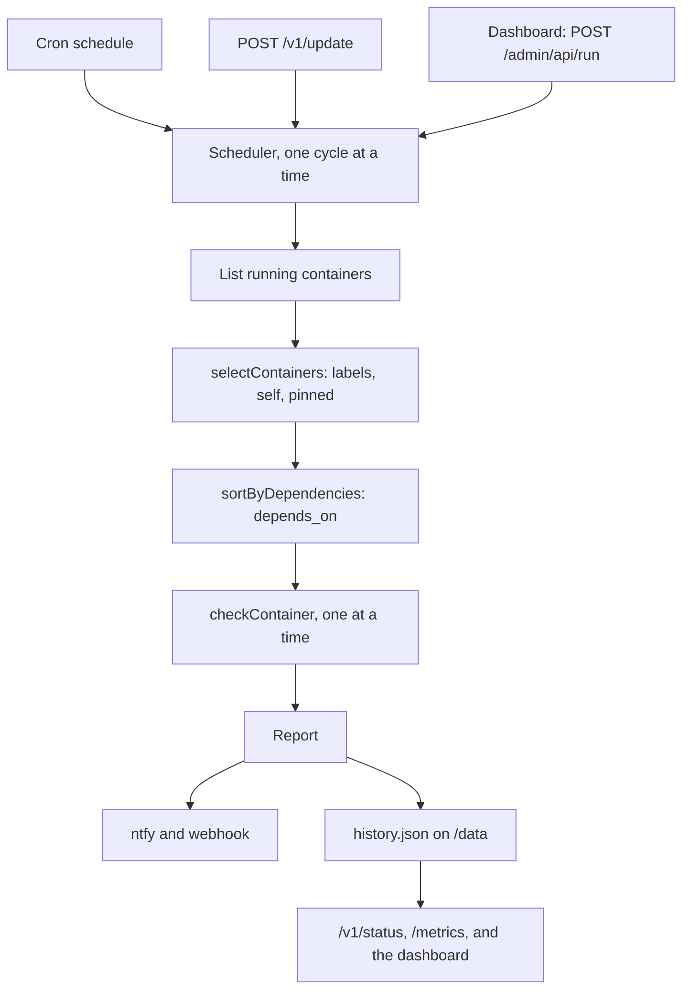

import { Terminology } from '@cbnventures/docusaurus-preset-nova/blocks';

Trace how a schedule tick or API call becomes an update <Terminology title="one pass over all selected containers" to="/docs/reference/terminology#cycle">cycle</Terminology>, how each container is checked and swapped, and how the image runs the whole thing without root.

## Overview

Outpost is a TypeScript monorepo that builds into one image. The packages keep each concern separate, and `apps/server` only wires them together:

| Workspace                | Responsibility                                                                                                                                                                                                                                                                                                                                                                                                                                    |
|--------------------------|---------------------------------------------------------------------------------------------------------------------------------------------------------------------------------------------------------------------------------------------------------------------------------------------------------------------------------------------------------------------------------------------------------------------------------------------------|
| `apps/server`            | Reads the environment, runs the cron schedule, keeps the check history, and serves the web dashboard and HTTP API.                                                                                                                                                                                                                                                                                                                                |
| `packages/updater`       | Selection, dependency order, the update <Terminology title="one pass over all selected containers" to="/docs/reference/terminology#cycle">cycle</Terminology>, and <Terminology title="swapping a container onto the new image" to="/docs/reference/terminology#recreation">recreation</Terminology> with <Terminology title="restoring the previous container after a failure" to="/docs/reference/terminology#rollback">rollback</Terminology>. |
| `packages/registry`      | Image reference parsing, `config.json` credentials, and digest lookups.                                                                                                                                                                                                                                                                                                                                                                           |
| `packages/docker-engine` | Typed Docker Engine API client over the unix socket or plain TCP.                                                                                                                                                                                                                                                                                                                                                                                 |
| `packages/notifiers`     | ntfy and webhook delivery that never throws.                                                                                                                                                                                                                                                                                                                                                                                                      |
| `packages/docker`        | s6-overlay service definitions and the image's root filesystem.                                                                                                                                                                                                                                                                                                                                                                                   |
| `apps/docs`              | This documentation site.                                                                                                                                                                                                                                                                                                                                                                                                                          |

## Update Cycle

1. **Trigger** — `Runner.trigger` in `apps/server/src/scheduler.ts` starts a <Terminology title="one pass over all selected containers" to="/docs/reference/terminology#cycle">cycle</Terminology> unless one is already running, so the schedule, the API, and the dashboard can never overlap. The dashboard can pass container IDs to limit the <Terminology title="one pass over all selected containers" to="/docs/reference/terminology#cycle">cycle</Terminology> to one container.
2. **Select** — `selectContainers` in `packages/updater/src/select.ts` applies the <Terminology title="whether containers are opted out or opted in" to="/docs/reference/terminology#label-mode">label mode</Terminology>, skips Outpost itself by matching `HOSTNAME` against container IDs, and skips images pinned to a digest or ID.
3. **Order** — `sortByDependencies` walks the `com.docker.compose.depends_on` label depth-first, scoped to each Compose project.
4. **Check** — `checkContainer` in `packages/updater/src/run.ts` compares the <Terminology title="registry manifest digest for an image tag" to="/docs/reference/terminology#remote-digest">remote digest</Terminology>, falls back to pull-and-compare, and hands off to <Terminology title="swapping a container onto the new image" to="/docs/reference/terminology#recreation">recreation</Terminology>.
5. **Report** — The results go to `notifyReport`, and the scheduler adds the <Terminology title="per-container results of a cycle" to="/docs/reference/terminology#report">report</Terminology> to the history and updates the running totals for the API.

## Dashboard and History

`createAdminRouter` in `apps/server/src/admin.ts` serves the static dashboard from `apps/server/public/admin` at `/admin/` and its JSON API under `/admin/api`. The app redirects `/` to `/admin/`.

- **Sessions** — `apps/server/src/session.ts` holds sessions for the single administrator in memory, with a CSRF token each and a 30-minute idle expiry. Failed sign-ins are counted per `request.ip`, 10 per 15 minutes.
- **Credentials** — The password is kept only as a SHA-256 digest. Username and password digests are compared in constant time.
- **History** — `apps/server/src/history.ts` keeps the newest 50 <Terminology title="per-container results of a cycle" to="/docs/reference/terminology#report">reports</Terminology> in `<OUTPOST_DATA_DIRECTORY>/history.json`. It writes through a temporary file and a rename, and validates the file with zod when loading.

The scheduler reads `lastReport` from the history, so `/v1/status`, `/metrics`, and the dashboard all show the same latest <Terminology title="per-container results of a cycle" to="/docs/reference/terminology#report">report</Terminology> after a restart.

## Digest Lookup

`fetchRemoteDigest` in `packages/registry/src/digest.ts` sends a `HEAD` request for the tag's manifest. The `Accept` header includes the OCI index and Docker manifest list types, so the registry returns the multi-platform digest that Docker records in `RepoDigests`.

When the registry answers `401`, the client follows the `WWW-Authenticate` challenge with a Bearer token request or Basic credentials. Any lookup error is caught, and the updater falls back to pulling the image and comparing image IDs.

## Recreation

`buildCreatePlan` in `packages/updater/src/plan.ts` turns the inspected container into a create body:

- **Image defaults** — Whole-value settings (`Cmd`, `Entrypoint`, `WorkingDir`, `User`, `Healthcheck`, `StopSignal`) that equal the old image's config are deleted. Env entries, labels, exposed ports, and volumes are filtered entry by entry.
- **Anonymous volumes** — Volume mounts not already covered by `Binds` or `Mounts` are added to `Binds` by volume name.
- **Networks** — Only one network can be attached at create time, so the primary network goes in `EndpointsConfig` and the rest are connected before start. Aliases equal to the old short ID are dropped.

`recreateContainer` in `packages/updater/src/recreate.ts` runs stop, rename to `<name>-outpost-previous`, create, connect, start, and `waitUntilHealthy`. Any error after the stop triggers the <Terminology title="restoring the previous container after a failure" to="/docs/reference/terminology#rollback">rollback</Terminology> path.

## Error Strategy

| Layer         | Strategy                                                                                                                                                                                                                                                                                                                                             |
|---------------|------------------------------------------------------------------------------------------------------------------------------------------------------------------------------------------------------------------------------------------------------------------------------------------------------------------------------------------------------|
| Config        | Invalid environment values stop startup with a readable message.                                                                                                                                                                                                                                                                                     |
| Engine client | Non-2xx responses throw with the daemon's error message.                                                                                                                                                                                                                                                                                             |
| Registry      | Lookup failures fall back to pull-and-compare.                                                                                                                                                                                                                                                                                                       |
| Recreation    | Any failure after stopping triggers <Terminology title="restoring the previous container after a failure" to="/docs/reference/terminology#rollback">rollback</Terminology>; a failed <Terminology title="restoring the previous container after a failure" to="/docs/reference/terminology#rollback">rollback</Terminology> is reported as `failed`. |
| Cycle         | One container's failure is recorded and the <Terminology title="one pass over all selected containers" to="/docs/reference/terminology#cycle">cycle</Terminology> continues.                                                                                                                                                                         |
| Notifications | Failures are collected and never thrown.                                                                                                                                                                                                                                                                                                             |
| History       | A missing or invalid file starts an empty history; save failures are logged and never thrown.                                                                                                                                                                                                                                                        |

Containers are never removed with their volumes, and Outpost never recreates its own container.

## Image and Process Model

The image is built on Debian trixie slim with s6-overlay as PID 1. The `server` service starts through `packages/docker/rootfs/etc/s6-overlay/s6-rc.d/server/run`:

1. Resolves the socket path from `DOCKER_HOST`.
2. Reads the group ID that owns the socket.
3. Runs `node build/index.js` with `s6-applyuidgid` as `PUID` and `PGID`, adding the socket's group as a supplementary group.

This is why Outpost needs neither root nor a `PGID` that matches the host's `docker` group. The image healthcheck calls `GET /health` on port `3000`.

## Dependency Injection

`runUpdateCycle` receives the Docker engine, `fetch`, the clock, `sleep`, and the credential lookup as arguments. Every decision, including <Terminology title="restoring the previous container after a failure" to="/docs/reference/terminology#rollback">rollback</Terminology> and the health wait, can be unit-tested without a Docker daemon.
