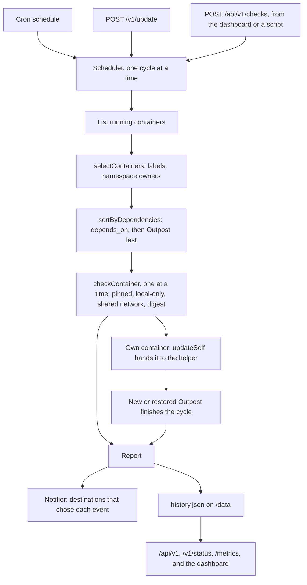

import { Terminology } from '@cbnventures/docusaurus-preset-nova/blocks';

Trace how a schedule tick or API call becomes an update <Terminology title="one pass over all selected containers" to="/docs/reference/terminology#cycle">cycle</Terminology>, how each container is checked and swapped, and how the image runs the updater as `PUID` and `PGID` instead of root.

## Overview

Outpost is a TypeScript monorepo that builds into one image. The packages keep Docker, registry, and update logic separate, and `apps/server` wires them together and owns the dashboard, the API, and notifications:

| Workspace                | Responsibility                                                                                                                                                                                                                                                                                                                                                                                                                                                   |
|--------------------------|------------------------------------------------------------------------------------------------------------------------------------------------------------------------------------------------------------------------------------------------------------------------------------------------------------------------------------------------------------------------------------------------------------------------------------------------------------------|
| `apps/server`            | Reads the environment, runs the cron schedule, keeps the check history, stores the account, <Terminology title="scoped key that scripts use to call the API" to="/docs/reference/terminology#access-token">access tokens</Terminology>, and notification <Terminology title="a place Outpost sends alerts to" to="/docs/reference/terminology#destination">destinations</Terminology> in SQLite, sends notifications, and serves the web dashboard and HTTP API. |
| `packages/updater`       | Selection, dependency order, the update <Terminology title="one pass over all selected containers" to="/docs/reference/terminology#cycle">cycle</Terminology>, and <Terminology title="swapping a container onto the new image" to="/docs/reference/terminology#recreation">recreation</Terminology> with <Terminology title="restoring the previous container after a failure" to="/docs/reference/terminology#rollback">rollback</Terminology>.                |
| `packages/registry`      | Image reference parsing, registry host names for sign-ins, and digest lookups.                                                                                                                                                                                                                                                                                                                                                                                   |
| `packages/docker-engine` | Typed Docker Engine API client over the unix socket or plain TCP.                                                                                                                                                                                                                                                                                                                                                                                                |
| `packages/docker`        | s6-overlay service definitions and the image's root filesystem.                                                                                                                                                                                                                                                                                                                                                                                                  |
| `apps/docs`              | This documentation site.                                                                                                                                                                                                                                                                                                                                                                                                                                         |

## Update Cycle

1. **Trigger** — `Runner.trigger` in `apps/server/src/scheduler.ts` starts a <Terminology title="one pass over all selected containers" to="/docs/reference/terminology#cycle">cycle</Terminology> unless one is already running, so the schedule, the API, and the dashboard can never overlap. It records what started each <Terminology title="one pass over all selected containers" to="/docs/reference/terminology#cycle">cycle</Terminology> (`schedule`, `startup`, `api`, or `dashboard`), and `POST /api/v1/checks` can pass a container ID to limit the <Terminology title="one pass over all selected containers" to="/docs/reference/terminology#cycle">cycle</Terminology> to that container.
2. **Select** — `selectContainers` in `packages/updater/src/select.ts` applies the <Terminology title="whether containers are opted out or opted in" to="/docs/reference/terminology#label-mode">label mode</Terminology> to every container, Outpost's own included, and excludes both sides of a shared network namespace and containers configured for automatic removal. Without its own ID, which comes from cgroup or mount metadata with a Docker-style hostname only as a fallback, it also skips every container whose image is named `outpost`.
3. **Order** — `sortByDependencies` walks the `com.docker.compose.depends_on` label depth-first, scoped to each Compose project. `runUpdateCycle` then moves Outpost's own container to the end, because updating it restarts Outpost.
4. **Check** — `checkContainer` in `packages/updater/src/run.ts` inspects the container and skips pinned images, shared network namespaces, and containers configured for automatic removal. It skips an image that Docker recorded as built on this host, then asks the registry for the <Terminology title="registry manifest digest for an image tag" to="/docs/reference/terminology#remote-digest">remote digest</Terminology>. An image Docker can't place, on Docker 28 or older with the containerd image store, is skipped as locally built when the registry doesn't have it or won't say without credentials. Otherwise it compares digests, where on Docker's containerd image store a matching image ID counts as up to date, falls back to pull-and-compare when the registry can't be reached, and hands off to <Terminology title="swapping a container onto the new image" to="/docs/reference/terminology#recreation">recreation</Terminology>, or for Outpost's own container to `updateSelf`, described in [Self-Update](#self-update).
5. **Report** — `notifyUpdateReport` in `apps/server/src/lib/notifier.ts` turns the <Terminology title="per-container results of a cycle" to="/docs/reference/terminology#report">report</Terminology> into at most one notification per <Terminology title="something a destination can be alerted about" to="/docs/reference/terminology#notification-event">event</Terminology>, and the scheduler adds the <Terminology title="per-container results of a cycle" to="/docs/reference/terminology#report">report</Terminology> to the history, updates the running totals for the API, and tells the event stream. Failures that stop the whole cycle become one failed result, so they are notified and retained too.

## Dashboard and History

`createApp` in `apps/server/src/app.ts` sets the 64 KB JSON body limit, the API rate limit of 120 requests per minute, and the trusted proxy check. It then registers one route module per area from `apps/server/src/routes`:

| Module             | Serves                                                                                                                                                                                                                                                                                                                                                                 |
|--------------------|------------------------------------------------------------------------------------------------------------------------------------------------------------------------------------------------------------------------------------------------------------------------------------------------------------------------------------------------------------------------|
| `web.ts`           | The dashboard at `/admin/`, with long caching for `/admin/assets`, a page fallback for every other `/admin` path, and the redirect from `/`.                                                                                                                                                                                                                           |
| `auth.ts`          | First-run setup, password sign-in with its code step, <Terminology title="device sign-in without a password or code" to="/docs/reference/terminology#passkey">passkey</Terminology> sign-in, sign-out, `GET /api/v1/auth/me`, and `DELETE /api/v1/auth/removed-secrets`.                                                                                               |
| `security.ts`      | The **Security** page: password and username changes, the authenticator app, <Terminology title="single-use code that replaces an authenticator code" to="/docs/reference/terminology#recovery-code">recovery codes</Terminology>, and <Terminology title="device sign-in without a password or code" to="/docs/reference/terminology#passkey">passkeys</Terminology>. |
| `tokens.ts`        | Listing, creating, editing, and revoking <Terminology title="scoped key that scripts use to call the API" to="/docs/reference/terminology#access-token">access tokens</Terminology>.                                                                                                                                                                                   |
| `notifications.ts` | Listing, adding, editing, testing, and removing notification <Terminology title="a place Outpost sends alerts to" to="/docs/reference/terminology#destination">destinations</Terminology>, and listing the <Terminology title="something a destination can be alerted about" to="/docs/reference/terminology#notification-event">events</Terminology> they can choose. |
| `dashboard.ts`     | The overview, containers, history, settings, status, checks, and event stream under `/api/v1`.                                                                                                                                                                                                                                                                         |
| `watchtower.ts`    | `POST /v1/update`, `GET /v1/status`, and `GET /metrics`.                                                                                                                                                                                                                                                                                                               |

The dashboard itself is a React app in `apps/server/src/web`, which Vite builds into `apps/server/build/admin`. Running `npm run mock` in `apps/server` serves it on port `5176` against an in-memory mock API.

- **Access** — `lib/access.ts` checks a bearer token first and the session cookie second, and enforces each route's <Terminology title="what an access token is allowed to do" to="/docs/reference/terminology#scope">scope</Terminology>. Session changes also need the `X-CSRF-Token` header, and the account, security, token, notification, and registry routes refuse tokens.
- **State** — `lib/state.ts` keeps the account, sessions, sign-in challenges, the authenticator app, <Terminology title="single-use code that replaces an authenticator code" to="/docs/reference/terminology#recovery-code">recovery codes</Terminology>, <Terminology title="device sign-in without a password or code" to="/docs/reference/terminology#passkey">passkeys</Terminology>, <Terminology title="scoped key that scripts use to call the API" to="/docs/reference/terminology#access-token">access tokens</Terminology>, notification <Terminology title="a place Outpost sends alerts to" to="/docs/reference/terminology#destination">destinations</Terminology>, and private registry sign-ins in `<OUTPOST_DATA_DIRECTORY>/outpost.sqlite3` through `node:sqlite`. An `account.json` from an earlier build is moved into the database once.
- **Secrets** — The password is a scrypt hash with a random salt (`N=32768`, `r=8`, `p=1`), and tokens, sessions, and <Terminology title="single-use code that replaces an authenticator code" to="/docs/reference/terminology#recovery-code">recovery codes</Terminology> are SHA-256 hashes. The authenticator secret, each <Terminology title="a place Outpost sends alerts to" to="/docs/reference/terminology#destination">destination</Terminology>'s <Terminology title="destination field that is sealed and never shown" to="/docs/reference/terminology#secret-field">secret fields</Terminology>, and each registry sign-in's password are sealed with AES-256-GCM using the <Terminology title="key file that seals saved secrets" to="/docs/reference/terminology#encryption-key">encryption key</Terminology> in `keys/installation.key`, which is checked against the database at startup.
- **Lost key** — When the key file is missing, `lib/state.ts` makes a new key, turns off the authenticator apps whose secrets the old key sealed, deletes their <Terminology title="single-use code that replaces an authenticator code" to="/docs/reference/terminology#recovery-code">recovery codes</Terminology>, and clears unfinished setups. It also drops every <Terminology title="a place Outpost sends alerts to" to="/docs/reference/terminology#destination">destination</Terminology>'s sealed secrets and lists those fields in `missing_secrets`, so the notifier skips the <Terminology title="a place Outpost sends alerts to" to="/docs/reference/terminology#destination">destination</Terminology> until they're entered again. Registry sign-ins keep their host and username but lose their password until it's entered again.
- **Removed secrets** — Each account that lost its authenticator app, each <Terminology title="a place Outpost sends alerts to" to="/docs/reference/terminology#destination">destination</Terminology> that lost secrets, and each registry sign-in that lost its password gets a row in `removed_secrets`, which `GET /api/v1/auth/me` returns as `removedSecrets`. A row goes away when its secret is entered again, or when `DELETE /api/v1/auth/removed-secrets` clears them all.
- **Setup code** — While no account exists, the state store creates a <Terminology title="one-time code that creates the dashboard account" to="/docs/reference/terminology#setup-code">setup code</Terminology> at startup and keeps only its SHA-256 digest and expiry in memory. The code itself goes only to the container log.
- **Attempt limits** — `lib/attempts.ts` counts failures per client address, 10 per 15 minutes, in memory. Sign-in methods and password confirmations share one count, and <Terminology title="one-time code that creates the dashboard account" to="/docs/reference/terminology#setup-code">setup codes</Terminology> have their own.
- **Proxies** — `lib/http.ts` trusts forwarded headers only from loopback and private addresses, and takes the scheme and hostname for <Terminology title="device sign-in without a password or code" to="/docs/reference/terminology#passkey">passkeys</Terminology> from each request.
- **Notifications** — `lib/notifier.ts` turns <Terminology title="per-container results of a cycle" to="/docs/reference/terminology#report">reports</Terminology>, sign-in lockouts, and a lost key into notifications, and `lib/notifications.ts` builds each service's request with a 10-second limit. Sends run in the background, and each <Terminology title="a place Outpost sends alerts to" to="/docs/reference/terminology#destination">destination</Terminology>'s last attempt and error are saved for the **Notifications** page.
- **History** — `apps/server/src/history.ts` keeps the newest 50 <Terminology title="per-container results of a cycle" to="/docs/reference/terminology#report">reports</Terminology> in `<OUTPOST_DATA_DIRECTORY>/history.json`. It writes through a temporary file and a rename, and validates the file with zod when loading.

The scheduler reads `lastReport` from the history, so `/v1/status` and `/metrics` show the same latest <Terminology title="per-container results of a cycle" to="/docs/reference/terminology#report">report</Terminology> after a restart. The dashboard's container table searches that newest-first history for each container's own latest result.

## Digest Lookup

`fetchRemoteDigest` in `packages/registry/src/digest.ts` sends a `HEAD` request for the tag's manifest. The `Accept` header includes the OCI index and Docker manifest list types, so the registry returns the multi-platform digest that Docker records in `RepoDigests`.

When the registry answers `401`, the client follows the `WWW-Authenticate` challenge with a Bearer token request or Basic credentials. Any lookup error is caught, and the updater falls back to pulling the image and comparing image IDs.

## Recreation

`buildCreatePlan` in `packages/updater/src/plan.ts` turns the inspected container into a create body:

- **Image defaults** — Whole-value settings (`Cmd`, `Entrypoint`, `WorkingDir`, `User`, `Healthcheck`, `StopSignal`) that equal the old image's config are deleted. Env entries, labels, exposed ports, and volumes are filtered entry by entry.
- **Anonymous volumes** — Volume mounts not already covered by `Binds` or `Mounts` are added to `Binds` by volume name.
- **Networks** — Only one network can be attached at create time, so the primary network goes in `EndpointsConfig` and the rest are connected before start. Aliases equal to the old short ID are dropped.

`recreateContainer` in `packages/updater/src/recreate.ts` runs stop, rename to `<name>-outpost-previous`, create, connect, start, and `waitUntilHealthy`. The wait rejects a stopped, non-running, restarting, unhealthy, or newly restarted replacement.

Any error after the stop triggers the <Terminology title="restoring the previous container after a failure" to="/docs/reference/terminology#rollback">rollback</Terminology> path.

## Self-Update

Outpost can't stop its own container and keep watching the replacement, so `apps/server/src/self-update.ts` hands that swap to a helper container:

1. **Hand over** — `handOver` writes the <Terminology title="one pass over all selected containers" to="/docs/reference/terminology#cycle">cycle</Terminology>'s results so far to `self-update.json` in the data directory, then starts `<name>-outpost-self-update` from the image Outpost runs now. The helper runs `node build/self-update-helper.js` without s6-overlay, with Outpost's environment, data and socket mounts, network, and the server's user and groups, but no ports, no healthcheck, and `io.cbnventures.outpost.enable=false`.
2. **Swap** — `apps/server/src/self-update-helper.ts` runs the same `recreateContainer` as every other update, adds its outcome to the file, and exits. Stopping Outpost normally ends the waiting `handOver`; if the helper exits first, or runs past the stop timeout plus the health timeout plus 60 seconds, `handOver` records why and removes it.
3. **Resume** — The Outpost running afterwards, new or restored, finds the pending <Terminology title="one pass over all selected containers" to="/docs/reference/terminology#cycle">cycle</Terminology> at startup, and `Runner.resume` holds the scheduler's lock while `finishSelfUpdate` waits for the helper. The resumed <Terminology title="one pass over all selected containers" to="/docs/reference/terminology#cycle">cycle</Terminology> keeps its original start time and trigger, and stands in for that start's **Check when Outpost starts** check.
4. **Report** — `finishSelfUpdate` adds Outpost's own result to the saved ones, so the <Terminology title="one pass over all selected containers" to="/docs/reference/terminology#cycle">cycle</Terminology> becomes one <Terminology title="per-container results of a cycle" to="/docs/reference/terminology#report">report</Terminology> that is notified and recorded once, even if Outpost restarts again. It removes the helper after an update or a <Terminology title="restoring the previous container after a failure" to="/docs/reference/terminology#rollback">rollback</Terminology>, and with cleanup on, the previous image after an update.
5. **Settle** — `Runner.settle` in `apps/server/src/handoff.ts` removes the file, or keeps only the ID of a new image that rolled back or failed, which `handOver` then skips. A helper that failed after stopping Outpost is kept for `docker logs`, and `removeExitedHelpers` removes stopped helpers, found by the `io.cbnventures.outpost.self-update-helper` label, at the next start.

Each release keeps the database readable by the release before it, because a <Terminology title="restoring the previous container after a failure" to="/docs/reference/terminology#rollback">rollback</Terminology> starts the old Outpost on the same data directory.

## Error Strategy

| Layer         | Strategy                                                                                                                                                                                                                                                                                                                                             |
|---------------|------------------------------------------------------------------------------------------------------------------------------------------------------------------------------------------------------------------------------------------------------------------------------------------------------------------------------------------------------|
| Config        | Invalid environment values stop startup with a readable message.                                                                                                                                                                                                                                                                                     |
| Engine client | Non-2xx responses throw with the daemon's error message.                                                                                                                                                                                                                                                                                             |
| Registry      | Lookup failures fall back to pull-and-compare.                                                                                                                                                                                                                                                                                                       |
| Recreation    | Any failure after stopping triggers <Terminology title="restoring the previous container after a failure" to="/docs/reference/terminology#rollback">rollback</Terminology>; a failed <Terminology title="restoring the previous container after a failure" to="/docs/reference/terminology#rollback">rollback</Terminology> is reported as `failed`. |
| Self-update   | A new image that rolled back or failed is skipped until a newer one appears, and a helper that failed after stopping Outpost is kept for its log.                                                                                                                                                                                                    |
| Cycle         | One container's failure is recorded and the <Terminology title="one pass over all selected containers" to="/docs/reference/terminology#cycle">cycle</Terminology> continues. A whole-cycle failure becomes one failed report.                                                                                                                        |
| Notifications | A failed send is saved on its <Terminology title="a place Outpost sends alerts to" to="/docs/reference/terminology#destination">destination</Terminology> and never thrown, so it can't stop a <Terminology title="one pass over all selected containers" to="/docs/reference/terminology#cycle">cycle</Terminology>.                                |
| History       | A missing or invalid file starts an empty history; save failures are logged and never thrown.                                                                                                                                                                                                                                                        |
| State         | A mismatched or damaged <Terminology title="key file that seals saved secrets" to="/docs/reference/terminology#encryption-key">encryption key</Terminology>, or a data directory that `PUID` can't use, stops startup instead of failing on first use. A missing key is replaced with a new one.                                                     |

Containers are never removed with their volumes, and Outpost never swaps its own container from inside it, because the self-update helper does that.

## Image and Process Model

The image is built on Debian trixie slim with s6-overlay as PID 1, which starts as root. Its `nova-container-init` step runs `packages/docker/rootfs/usr/local/libexec/nova-docker/init-user` as root only to prepare `/data`: it checks `PUID`, `PGID`, and `TZ`, then creates `/data` and hands it to `PUID` and `PGID`.

The `server` service then starts through `packages/docker/rootfs/etc/s6-overlay/s6-rc.d/server/run`:

1. Resolves the socket path from `DOCKER_HOST`.
2. Reads the group ID that owns the socket.
3. Runs `node build/index.js` with `s6-applyuidgid` as `PUID` and `PGID`, adding the socket's group as a supplementary group.

The updater process therefore runs as `PUID` and `PGID`, never as root, and `PGID` doesn't need to match the host's `docker` group. The image healthcheck calls `GET /health` on port `3000`.

:::warning
Access to the Docker socket is equivalent to root on the host, because the Docker API can start privileged containers and mount any host path. Running the updater as `PUID` limits the process itself, not what it can ask Docker to do.
:::

## Dependency Injection

`runUpdateCycle` receives the Docker engine, `fetch`, the clock, `sleep`, the credential lookup, and the `updateSelf` step as arguments. Every decision, including <Terminology title="restoring the previous container after a failure" to="/docs/reference/terminology#rollback">rollback</Terminology>, the health wait, and the hand-off of Outpost's own container, can be unit-tested without a Docker daemon.
